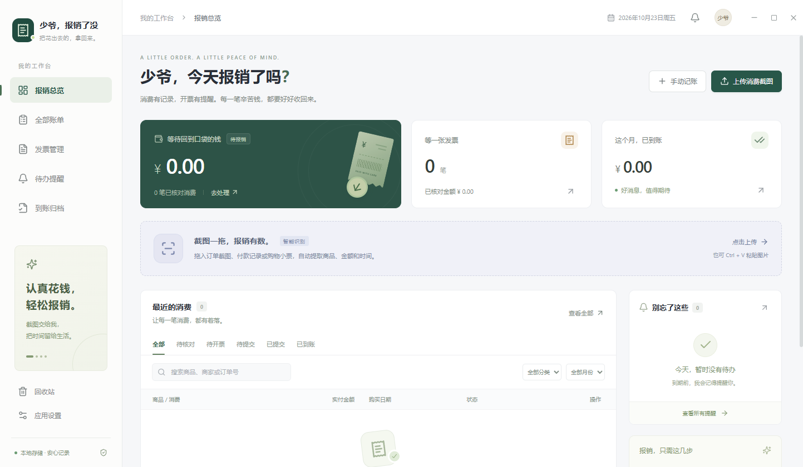

# 少爷今天报销了吗

Windows 桌面报销助手：把购物截图、付款记录和小票变成可核对的账单，整理电子发票与报销材料，再提醒开发票、提交报销和跟进到账。

本仓库包含源码和合成测试样例，不包含个人账本、真实发票、依赖目录或安装包。首次克隆后请按“开发与构建”运行；下方 `release/` 中的安装程序与“启动应用.cmd”需要先执行 `npm run package` 生成。

## 直接使用

- 双击项目根目录的 **启动应用.cmd**，无需安装 Node.js。
- 或运行 **release/1.1.1/Shaoye-Reimburse-Setup-1.1.1.exe** 安装。安装版可在设置中启用开机启动。
- 免安装程序在 **release/1.1.1/win-unpacked/少爷今天报销了吗.exe**。请保留 win-unpacked 文件夹的完整内容，不要只移动其中一个 EXE。
- **示例消费截图.png** 是人工生成的测试图片，包含“罗技无线鼠标 / 实付 299.00 元 / 2026-10-20”。样例不会自动写入正式账本，可以自行上传体验。

## 日常流程

1.1.1 修复消费截图识别完成后自动跳页的问题：上传、拖入或粘贴图片后保留当前页面，首页会更新消费列表，不自动弹出详情。需要核对时，点击对应账单或“核对账单”。

1.1.0 新增发票批量导入、订单匹配和报销材料 ZIP 导出，并保留 1.0.1 的 PP-OCRv4 离线中文识别、长截图分段、淘宝与京东实付金额和多行名称提取。升级前完全退出旧程序（包括托盘），运行新版安装包；账本仍保存在原数据目录。旧截图可在账单详情点击“重新识别原图”，再次核对并保存。重新识别会保留原有报销进度、自定义提醒日期、备注和附件。

1. 点击“上传消费截图”，拖入图片，或 Ctrl + V 粘贴截图。支持 PNG、JPG、WEBP、BMP；一批最多 20 张，每张最多 20 MB。
2. 对照原图核对商品、商家、实付金额、日期、订单号和分类。识别失败时原图仍会保存，可手动填写或重新识别。
3. 核对并保存。**未核对金额不计入总额**。当前金额统一按人民币记录。
4. 到商家申请发票后，在“发票管理”批量导入 PDF 或图片，核对关联订单。向公司提交后标记“已提交”，收到钱后确认“已到账”。账单详情也支持追加发票附件。
5. 在“发票管理”导出报销材料 ZIP；账单页仍可单独导出 CSV。设置中可保存常用开票抬头、调整提醒，或备份完整账本和附件。

默认开票提醒为购买后 7 天，报销提醒为购买后 30 天，提前 3 天出现在待办中，每天 09:00 检查并发送汇总通知。每笔账单可单独调整提醒日期。已提交的账单按报销提醒日提示跟进到账，已到账停止提醒。

关闭窗口默认保留系统托盘运行，右键托盘图标可以完全退出。**关机、休眠或完全退出应用期间不会发出通知**，再次启动或恢复后会检查待办。Windows 通知开关和勿扰模式会影响显示，可在设置中发送测试通知。

## 发票管理与报销材料

在左侧打开“发票管理”，点击“批量导入发票”，或拖入文件。支持 PDF、PNG、JPG/JPEG、WEBP、BMP，一次最多 50 份，每份最多 20 MB。界面会逐份显示成功匹配、待确认、重复和失败结果。

- **保留原文件**：新导入的 PDF、JPG 等按原格式、原始内容保存，打开和导出使用原文件。PDF 优先读取文字，扫描型 PDF 会在本机转换页面进行识别；识别过程不会替换保存的 PDF。
- **仅匹配已有订单**：自动关联只考虑已核对、未报销且未删除的消费订单，需要足够且唯一的匹配依据。只凭相同金额、存在多个候选或识别不确定时，保留为待确认；可选择对应的未报销订单手工关联。导入发票不会创建消费记录，也不会覆盖订单的商品名称、金额、购买日期或核对状态。已核对的待开票订单关联发票后进入“待提交”。
- **一单多票**：同一订单可以关联多份发票，追加附件不会替换已有文件。账单详情的“打开”查看首份，“查看全部发票”进入完整列表。完全相同的文件按内容去重；同名但内容不同的文件可以保留。
- **一份文件含多张发票**：保留文件为待确认，请按发票拆分后重新导入。若文件中任一 20 位票号已经用于已报销订单，整份文件按已报销副本处理，不能再次关联，也不会进入默认导出；移除原来的历史发票不会解除这一限制。
- **确认与移除**：可搜索原文件名、销售方、发票号和订单，筛选待确认、已匹配或已报销。未报销发票可调整或解除关联；已报销发票不能直接改挂其他订单。移除发票需要确认，属于软删除，原文件仍保留；重新导入同一文件可恢复。
- **提交报销的 ZIP**：点击“导出报销材料 ZIP”选择保存位置。包内包含报销清单、按订单归档的发票原文件和导出说明；自动排除已报销订单、回收站订单及已移除发票。一笔订单有多张发票时，清单只列一行，金额不会重复累计。
- **清单严格五列**：`商品 / 消费`、`商家`、`金额（CNY）`、`购买日期`、`备注`。内容取自有发票的已核对、未报销订单，日期示例为 `2026/9/9`。未匹配发票以及关联未核对订单的发票，均放入 ZIP 的 `待确认发票/` 文件夹，不进入清单或金额统计；确认订单后可重新导出。
- **导出不改变报销状态**：打包成功不代表已经提交或到账，请按实际进度自行更新。只有待确认发票时也能导出，清单仅保留表头。

旧版账单附件会自动纳入发票管理。旧版曾把图片转换为 PNG，已经无法还原上传前的 JPG 等文件；此类附件会显示提示。需要原始格式时，请重新导入自己保留的原文件。旧 PDF 附件保留其 PDF 格式。

## 数据与备份

默认正式数据目录为 **%APPDATA%\ShaoyeReimburse**，可以在应用设置中直接打开。

- ledger.json：账本、发票登记与关联关系、设置，串行保存，使用临时文件原子替换。
- ledger.json.bak：上一次保存的账本。主文件损坏时尝试恢复，同时保留损坏文件。
- attachments/：消费原图与发票文件；1.1.0 新导入发票保留原格式和原始内容。
- before-restore-*.json：恢复外部备份前自动保存的旧账本。

回收站支持恢复，移除账单不会删除原图。完整备份含原图、发票及其关联关系，也包含尚未匹配的发票；附件超过 200 MB 时，请在退出应用后复制整个数据目录。单独的 CSV 仅含清单，不含文件。用于提交报销的 ZIP 不是完整账本备份。

图片和 PDF 在本机识别，不上传云端，不需要 API Key。数据不自动同步，也不会代替你在商家平台开票或在公司系统提交报销。

## 开发与构建

要求 Windows 10/11 x64，Node.js 22.13+ 或 24+（已用 Node 24 验证，PDF.js 要求 Node 22.13.0 及以上）。

    npm ci
    node node_modules/electron/install.js
    npm run prepare:ocr
    npm run dev

首次准备依赖与模型需要联网。正常运行时不需要联网。

如果 Electron 官方下载无法连接，可在 PowerShell 中设置本次命令使用的公开镜像：

    $env:ELECTRON_MIRROR='https://npmmirror.com/mirrors/electron/'
    node node_modules/electron/install.js

构建与运行：

    npm run build
    npm start

生成 Windows 安装包：

    npm run package

如果安装包工具下载超时：

    $env:ELECTRON_BUILDER_BINARIES_MIRROR='https://npmmirror.com/mirrors/electron-builder-binaries/'
    npm run package

PP-OCRv4 中文模型和词典随固定版本 @gutenye/ocr-models 打包，prepare:ocr 会验证 SHA256。增强引擎在工作线程中逐图运行、完成后回收，长截图重叠分段后按坐标拼接。基础中英文后备语言包位于 assets/tessdata/。不需要用户安装 Python、模型或 GPU 驱动。

图标和简单收据生成脚本为 scripts/make-assets.ps1；仿淘宝、京东布局的合成测试图片生成脚本为 scripts/make-ocr-fixtures.ps1（不含真实用户订单）。

技术栈：Electron 45、React 19、TypeScript、Vite、PP-OCRv4 / ONNX Runtime CPU、Tesseract.js 7 后备；PDF 使用 PDF.js 与 @napi-rs/canvas，ZIP 使用 yazl。界面使用 context isolation 和 sandbox，通过限定 API 访问本机文件。主进程验证输入、附件大小、金额、日期和备份结构。安装包未配置商业代码签名证书。

## 测试

桌面测试读取 `dist/`，请先安装依赖、准备 OCR 模型并完成构建：

    npm run prepare:ocr
    npm run build
    npm test
    npm run test:ocr
    npm run test:invoice-reader
    npm run test:e2e
    npm run test:invoices

测试覆盖金额局部标签归属、商品/规格/收货信息过滤、多行标题、拆开的小数、订单日期优先级、长图拼接、提醒边界、输入校验、CSV 公式保护、并发保存、损坏恢复和备份校验。发票测试覆盖价税合计与销售方提取、同金额歧义、已报销排除、多票关联、原文件保留、旧附件迁移、五列 CSV 与实际 ZIP 内容、待确认文件隔离及备份关联恢复。test:ocr 会实际识别合成电商截图、480px JPEG 压缩版本、5230px 长图和空白图；这不代表任意真实订单均已验证。test:invoice-reader 实际读取合成文字 PDF、扫描 PDF 和 JPG 发票。test:e2e 验证真实 OCR 调用、状态流转、重新识别、图片去重、附件、导出、备份恢复和重启持久化；test:invoices 验证桌面发票管理流程。

测试打包后的 EXE：

    $env:SHAOYE_EXECUTABLE=(Resolve-Path 'release/1.1.1/win-unpacked/少爷今天报销了吗.exe').Path
    npm run test:e2e
    npm run test:invoices

测试数据、截图和结果位于 test-results/，不会混入正式账本。

## 范围与限制

- 一张图片生成一笔消费记录；多商品订单可在名称或备注中补充，金额按订单实付总额核对。
- 清晰、正向截图识别更可靠；模糊照片、花纹背景、手写和复杂排版可能需要裁剪或手动修正。识别结果始终要求人工核对。
- PDF 发票支持文字读取和扫描页识别，最多识别前 10 页，原文件完整保存。加密、损坏或识别失败时会显示提示并保留可接收的原文件；请人工关联，或提供可读取的无密码文件。
- 当前为本机单用户账本，不含公司审批、多设备同步或云端账号。

参考：[Electron 安全建议](https://www.electronjs.org/docs/latest/tutorial/security)、[Guten OCR](https://github.com/gutenye/ocr)、[PaddleOCR](https://github.com/PaddlePaddle/PaddleOCR)、[Tesseract.js API](https://github.com/naptha/tesseract.js/blob/master/docs/api.md)。

第三方许可见 THIRD_PARTY_NOTICES.txt、模型目录的 LICENSE.txt，以及打包程序中各组件的许可文件。
